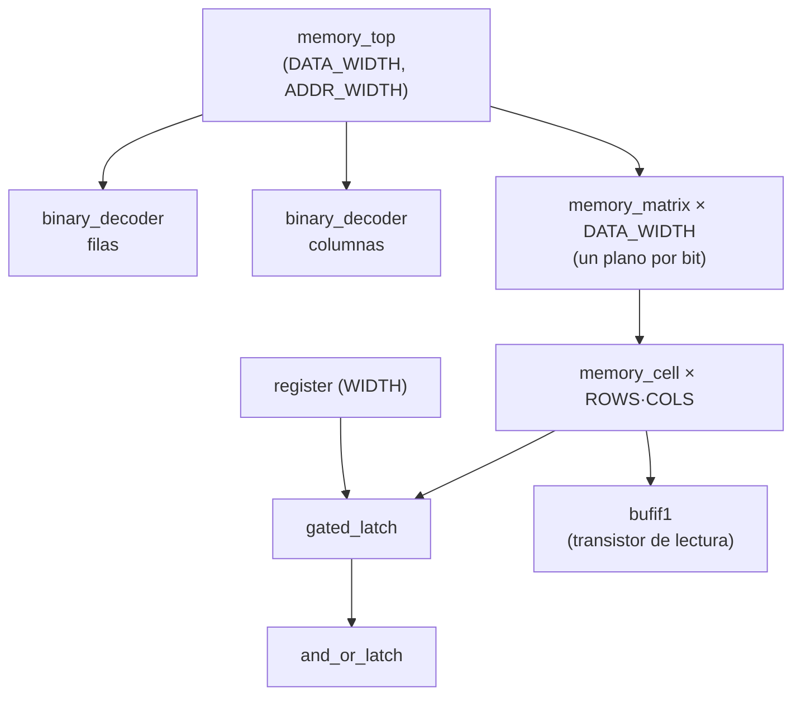

# Memoria parametrizada en SystemVerilog — de la compuerta al byte

**Universidad del Istmo · FING · Ingeniería Electrónica y Telecomunicaciones**
Catedrático: Víctor Vargas · Examen Final — Puntos extra

Implementación en SystemVerilog de la estructura de memoria explicada en el video
**"How Transistors Remember Data"** (canal *Core Dumped*). El diseño reproduce la misma
jerarquía del video, desde una compuerta OR realimentada hasta una memoria de
`2^ADDR_WIDTH` palabras de `DATA_WIDTH` bits. El módulo top es `memory_top` y está
parametrizado.

## 🎥 Video explicativo

[](https://youtu.be/-SgSwvpW3xI)

▶️ **https://youtu.be/-SgSwvpW3xI**

En el video se recorre el código de abajo hacia arriba (latch → registro → matriz →
memoria), se ejecuta la simulación en la terminal y se explican las formas de onda.

## 📄 Documentos

| Documento | Contenido |
|---|---|
| [`docs/Informe_memoria.pdf`](docs/Informe_memoria.pdf) | Informe completo: marco teórico, diseño, verificación, resultados y conclusiones. |
| [`docs/Guion_video.pdf`](docs/Guion_video.pdf) | Guion usado para grabar el video. |

## Contenido

- [Jerarquía del diseño](#jerarquía-del-diseño)
- [Interfaz de `memory_top`](#interfaz-de-memory_top)
- [Cómo funciona por dentro](#cómo-funciona-por-dentro)
- [Verificación](#verificación)
- [Resultados](#resultados)
- [Cómo ejecutarlo](#cómo-ejecutarlo)
- [Estructura del repositorio](#estructura-del-repositorio)
- [Notas de diseño](#notas-de-diseño)
- [Referencias](#referencias)

## Jerarquía del diseño



| Nivel | Archivo | Qué hace (según el video) |
|---|---|---|
| 1 | [`rtl/and_or_latch.sv`](rtl/and_or_latch.sv) | OR realimentada que "recuerda" un 1, más una AND con RESET invertido para poder borrar. `Q = (Q \| SET) & ~RESET` |
| 2 | [`rtl/gated_latch.sv`](rtl/gated_latch.sv) | Una sola línea de dato: `SET = D·WE`, `RESET = ~D·WE`. Si `WE = 0`, el valor se conserva. |
| 3 | [`rtl/register.sv`](rtl/register.sv) | `WIDTH` gated latches con un `WRITE_ENABLE` común (ej. 92 = `01011100`). Así son los registros del CPU. |
| 4a | [`rtl/binary_decoder.sv`](rtl/binary_decoder.sv) | Decodificador `N → 2^N` one-hot. Convierte la dirección en un cable de fila y uno de columna. |
| 4b | [`rtl/memory_cell.sv`](rtl/memory_cell.sv) | Celda = gated latch + `AND(fila, columna)` para seleccionarla + "transistor" tri-estado (`bufif1`) que la conecta a la línea `D_in/out` sólo al leer. |
| 4c | [`rtl/memory_matrix.sv`](rtl/memory_matrix.sv) | Cuadrícula `ROWS × COLS` de celdas que comparten `WE`, `RE` y **una sola** línea de datos. |
| 5 | [`rtl/memory_top.sv`](rtl/memory_top.sv) | **Top.** Apila `DATA_WIDTH` matrices que comparten la misma dirección; cada una aporta un bit de la palabra. |

Todos los bloques internos usan compuertas primitivas (`and`, `or`, `not`, `bufif1`),
por lo que el código corresponde directamente al circuito del video.

## Interfaz de `memory_top`

| Puerto | Dir. | Ancho | Descripción |
|---|---|---|---|
| `address` | in | `ADDR_WIDTH` | Bus de direcciones. Bits altos → filas, bits bajos → columnas. |
| `write_enable` | in | 1 | Con `1`, la palabra en `data` se guarda en `address`. |
| `read_enable` | in | 1 | Con `1`, la memoria coloca en `data` la palabra de `address`. |
| `data` | inout | `DATA_WIDTH` | Bus de datos (D_in/out). En alta impedancia (`Z`) cuando `read_enable = 0`. |

| Parámetro | Por defecto | Efecto |
|---|---|---|
| `DATA_WIDTH` | 8 | Bits por palabra = número de matrices apiladas. |
| `ADDR_WIDTH` | 4 | Capacidad = `2^ADDR_WIDTH` palabras (4 → 16 bytes; 32 → 4 294 967 296 bytes). |

Parámetros derivados: `COL_BITS = ADDR_WIDTH/2`, `ROW_BITS = ADDR_WIDTH − COL_BITS`,
`ROWS = 2^ROW_BITS`, `COLS = 2^COL_BITS`.

```systemverilog
memory_top #(
    .DATA_WIDTH(8),
    .ADDR_WIDTH(4)
) u_mem (
    .address      (addr),
    .write_enable (we),
    .read_enable  (re),
    .data         (data_bus)   // wire bidireccional
);
```

## Cómo funciona por dentro

**Escritura** (dirección `1001`, dato `10111100`, el ejemplo del video)
1. La dirección se divide: `10` → el decodificador de filas activa la fila 2; `01` → el de columnas activa la columna 1.
2. En cada una de las 8 matrices, sólo la celda (2,1) tiene activas su fila **y** su columna.
3. Al subir `write_enable`, sólo esa celda recibe `WE` en su gated latch y copia el bit de su línea de datos. Las demás tienen `WE = 0` y conservan su valor.

**Lectura**
1. Los decodificadores seleccionan la misma celda.
2. Con `read_enable = 1`, sólo el `bufif1` de la celda seleccionada conduce y coloca su bit en la línea compartida. Las demás celdas quedan en alta impedancia; por eso todas pueden compartir un solo cable.

**Ahorro de cableado.** Para 16 bits, conectar cada latch por separado requiere 32 cables
(16 de entrada y 16 de salida). Con la matriz bastan 4 bits de dirección, `WE`, `RE` y
una línea de datos: 7 señales.

**Secuencia segura.** Los latches son sensibles a nivel, no a flanco. La dirección y el
dato deben estar estables **antes** de subir `write_enable` y no cambiar hasta
**después** de bajarlo.

## Verificación

Dos testbenches autoverificables comparan cada resultado contra el valor esperado y
terminan con `PASS` o `FAIL`.

| Testbench | Prueba | Qué verifica |
|---|---|---|
| `tb_latches` | AND-OR latch | SET y RESET, y que el valor se mantiene al soltarlos. |
| | Gated latch | Copia D con `WE = 1`; ignora D con `WE = 0`. |
| | Registro 8 bits | Guarda 92 = `01011100` y no cambia con `WE = 0`. |
| `tb_memory_top` | 1. Ejemplo del video | Escribir `10111100` en `1001` y leerlo. |
| | 2. Alta impedancia | Con `read_enable = 0` el bus queda en `ZZZZZZZZ`. |
| | 3. Todas las direcciones | Escribir y leer las 16 direcciones contra un modelo de referencia. |
| | 4. Aislamiento | Sobrescribir `1001` sin alterar las demás. |
| | 5. `LOAD R0 1001` | La memoria pone el byte en el bus y un `register` lo captura, como el CPU del video. |

Configuraciones probadas, todas con 0 errores:

| `DATA_WIDTH` | `ADDR_WIDTH` | Palabras | Matriz por bit | Resultado |
|---|---|---|---|---|
| 8 | 4 | 16 | 4 × 4 | ✅ PASS |
| 1 | 1 | 2 | 2 × 1 | ✅ PASS |
| 4 | 3 | 8 | 4 × 2 | ✅ PASS |
| 16 | 6 | 64 | 8 × 8 | ✅ PASS |
| 32 | 8 | 256 | 16 × 16 | ✅ PASS |

## Resultados

### Simulación en la terminal (Icarus Verilog 12, Windows)


### Formas de onda (GTKWave)

Escritura de `10111100` en la dirección `1001` y lectura posterior:


| Tiempo | Señales | Qué ocurre |
|---|---|---|
| 0 – 10 ns | `address = 0000`, `data = Z` | Reposo: nadie maneja el bus. |
| 10 ns | `address = 1001`, `data = 10111100` | Se colocan la dirección y el dato. |
| 15 – 20 ns | `write_enable = 1` | Sólo la celda (2,1) de cada matriz captura su bit. |
| 25 – 30 ns | `data = Z` | El bus se suelta; la memoria aún no lee. |
| 30 – 35 ns | `read_enable = 1`, `data = 10111100` | La memoria, por sí sola, devuelve el byte guardado. |

En hexadecimal (vista por defecto de GTKWave), `9` = `1001` y `BC` = `10111100`:


## Cómo ejecutarlo

Requiere [Icarus Verilog](https://bleyer.org/icarus/) ≥ 11 y, opcionalmente, GTKWave
(viene incluido en el instalador de Windows).

### Windows (PowerShell)

> Instala Icarus en una ruta **sin espacios** (por ejemplo `C:\iverilog`) y marca
> *"Add executable folder(s) to the user PATH"*. El proyecto también debe estar en una
> ruta sin espacios, por ejemplo `C:\proyectos\memoria-sv`.

```powershell
cd C:\proyectos\memoria-sv
mkdir build

# Latches y registro
iverilog -g2012 -s tb_latches -o build/tb_latches.vvp rtl/and_or_latch.sv rtl/gated_latch.sv rtl/register.sv rtl/binary_decoder.sv rtl/memory_cell.sv rtl/memory_matrix.sv rtl/memory_top.sv tb/tb_latches.sv
vvp build/tb_latches.vvp

# Memoria completa
iverilog -g2012 -s tb_memory_top -o build/tb_memory_top.vvp rtl/and_or_latch.sv rtl/gated_latch.sv rtl/register.sv rtl/binary_decoder.sv rtl/memory_cell.sv rtl/memory_matrix.sv rtl/memory_top.sv tb/tb_memory_top.sv
vvp build/tb_memory_top.vvp

# Formas de onda
gtkwave build/tb_memory_top.vcd
```

Para otro tamaño, agrega los parámetros al `iverilog` de la memoria:
`-P tb_memory_top.DATA_WIDTH=16 -P tb_memory_top.ADDR_WIDTH=6`

### Linux / macOS (make)

```bash
make                                   # latches/registro + memoria 8x16
make mem DATA_WIDTH=16 ADDR_WIDTH=6    # otra configuración
make sweep                             # las 5 configuraciones
make wave                              # abre las ondas en GTKWave
python3 scripts/plot_waves.py          # regenera docs/waveform.png
```

### En GTKWave

1. Haz clic en `tb_memory_top` en el panel izquierdo.
2. Selecciona `address`, `data`, `read_enable` y `write_enable`, y presiona **Append**.
3. Escribe `0` y `45 ns` en **From** / **To**.
4. En el panel *Signals*, clic derecho sobre `address` y `data` → **Data Format → Binary**.

## Estructura del repositorio

```
memoria-sv/
├── rtl/                     diseño
│   ├── and_or_latch.sv
│   ├── gated_latch.sv
│   ├── register.sv
│   ├── binary_decoder.sv
│   ├── memory_cell.sv
│   ├── memory_matrix.sv
│   └── memory_top.sv        ← módulo top parametrizado
├── tb/                      testbenches autoverificables
│   ├── tb_latches.sv
│   └── tb_memory_top.sv
├── docs/
│   ├── Informe_memoria.pdf
│   ├── Guion_video.pdf
│   ├── waveform.png
│   └── img/                 capturas de la simulación
├── scripts/plot_waves.py    gráfico de formas de onda desde el .vcd
├── Makefile
└── README.md
```

## Notas de diseño

- Es una memoria tipo **SRAM basada en latches** y es **asíncrona**: no tiene reloj. Se modeló a nivel de compuertas y con lazos combinacionales, igual que el video. En FPGA o ASIC, para memorias grandes se usarían flip-flops con reloj o bloques de RAM dedicados; este diseño es didáctico.
- Los bits nunca escritos se leen como `X` en simulación, porque el latch arranca en un estado desconocido, igual que una SRAM real al encender.
- Como menciona el video, cada bit de SRAM ocupa varios transistores. Por eso la memoria principal de los computadores usa DRAM (un capacitor por bit), y la SRAM se reserva para registros y caché.

## Referencias

- Core Dumped, *How Transistors Remember Data* — https://www.youtube.com/watch?v=rM9BjciBLmg
- D. Harris y S. Harris, *Digital Design and Computer Architecture*, 2.ª ed., Morgan Kaufmann.
- IEEE Std 1800-2017, *IEEE Standard for SystemVerilog*.
- Icarus Verilog — https://steveicarus.github.io/iverilog/
